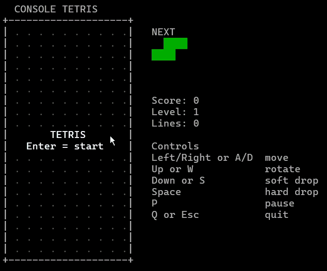
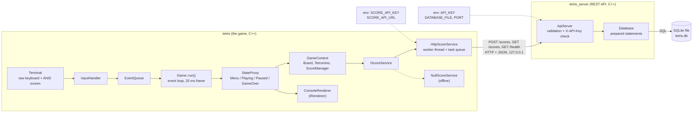
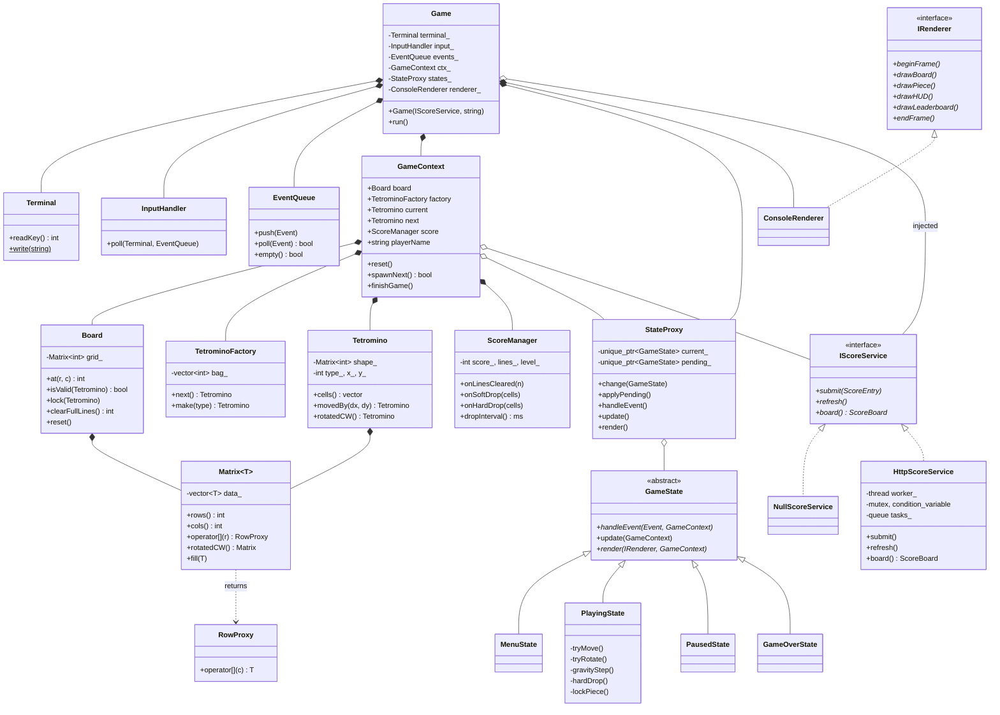
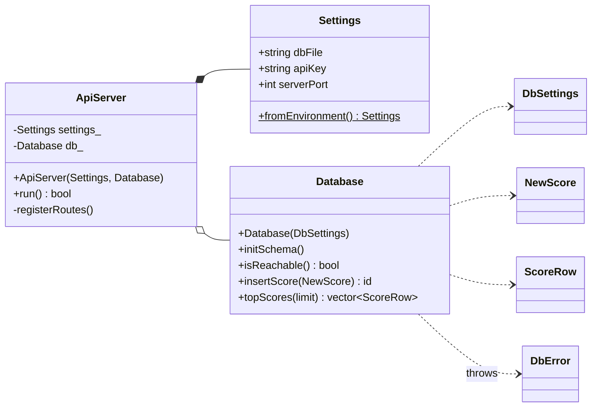

# Console-Based Tetris Clone

A block-stacking Tetris game for the terminal, written in object-oriented C++17, with an **online leaderboard**. When a game ends, the score is sent to a **REST API** (also written in C++) that stores it in a **SQLite** database file, and the game reads the top scores back and shows them on screen.

The whole project is C++. The game needs no libraries and runs on Linux, macOS and Windows. The leaderboard is optional: without it the game is a normal offline Tetris.

```
  CONSOLE TETRIS
+--------------------+
| .  .  .  .  .  .  .  .  .  .|   NEXT
| .  .  .  .  .  .  .  .  .  .|   ...
| .  .  .  .  .  .  .  .  .  .|   Score: 1200
| .  .  .  .  .  .  .  .  .  .|   Level: 2
| .  .  .  .  .  .  .  .  .  .|   Lines: 11
|          GAME OVER           |   LEADERBOARD
| .  .  .  .  .  .  .  .  .  .|    1. Alice         3400
| .  .  .  .  .  .  .  .  .  .|    2. Gourav        1200
+--------------------+
```



## Features

- All 7 tetrominoes (I, O, T, S, Z, J, L) with matrix-based rotation
- Fair 7-bag randomizer, wall kicks, soft drop, hard drop, next-piece preview
- Scoring, line clears and levels, with gravity that speeds up as you level
- Menu, pause and game-over screens
- **Online leaderboard** through a REST API backed by a SQLite database (one file, nothing to install)
- Secrets and settings read from **environment variables**, never from source files
- The game never freezes if the server is slow or offline (network calls run on a background thread)

## How the pieces fit together (end-to-end flow)

```
 +----------------+   HTTP + JSON    +---------------------+     SQL      +-----------+
 |  tetris        | ---------------> |  tetris_server      | -----------> |  SQLite   |
 |  (the game)    | <--------------- |  (REST API, C++)    | <----------- |  tetris.db|
 +----------------+   top scores     +---------------------+    rows      +-----------+
   reads SCORE_API_KEY                  reads API_KEY
   and SCORE_API_URL                    (and optionally DATABASE_FILE)
   from the environment                 from the environment
```

1. The player types a name, plays, and the stack reaches the top (game over).
2. The game calls `POST /scores` with the name, score, level and lines.
3. The server checks the `X-API-Key` header, validates the data and `INSERT`s a row into the SQLite database.
4. The game then calls `GET /scores?limit=8` and draws the returned top scores next to the board.

## Controls

| Key | Action |
|---|---|
| `Left` / `A` | Move left |
| `Right` / `D` | Move right |
| `Up` / `W` | Rotate clockwise |
| `Down` / `S` | Soft drop |
| `Space` | Hard drop |
| `P` | Pause / resume |
| `Enter` | Start, resume or play again |
| `Q` / `Esc` | Quit |

## Scoring

| Action | Points |
|---|---|
| 1 / 2 / 3 / 4 lines cleared at once | 100 / 300 / 500 / 800, multiplied by the current level |
| Soft drop | 1 per cell |
| Hard drop | 2 per cell |

You level up every 10 lines. The time between automatic falls starts at 800 ms and shrinks by 70 ms per level, down to a minimum of 100 ms.

## Environment variables

Passwords and keys are **not** written in any file. Both programs read them from the environment while they run, using `std::getenv` (see `src/Env.h`).

| Variable | Used by | Required | Default | Meaning |
|---|---|---|---|---|
| `API_KEY` | server | **yes** | - | Key that clients must send in the `X-API-Key` header |
| `DATABASE_FILE` | server | no | `tetris.db` | Path of the SQLite database file (created automatically) |
| `PORT` | server | no | `5000` | Port the REST API listens on (localhost only) |
| `SCORE_API_KEY` | game | no | - | Same value as the server's `API_KEY`. **If it is not set, the game runs offline without a leaderboard.** |
| `SCORE_API_URL` | game | no | `http://127.0.0.1:5000` | Where the REST API is |

The server refuses to start if `API_KEY` is missing, and says so. SQLite has no database password, so the API key is the only secret.

Set them in the same terminal window before starting the program:

```bash
# Linux / macOS
export API_KEY='a-long-random-string'
```

```powershell
# Windows PowerShell
$env:API_KEY = "a-long-random-string"
```

Any long random text works as a key. Variables set this way last only for that terminal window.

## Requirements

- A C++17 compiler: `g++` 7+, `clang++`, or MSVC (Visual Studio 2017+)
- A terminal that supports ANSI colors (any Linux/macOS terminal, or Windows Terminal / PowerShell on Windows 10+)
- CMake 3.12+ (optional)

The three third-party libraries are included in the project, so nothing needs to be installed for them: [cpp-httplib](https://github.com/yhirose/cpp-httplib) (HTTP) and [nlohmann/json](https://github.com/nlohmann/json) (JSON), both MIT licensed, in `src/third_party/`, and [SQLite](https://www.sqlite.org) (public domain, the database engine), as one C file in `server/third_party/`.

## Build

The first compile of each program takes 20 to 30 seconds, because the HTTP library is large. SQLite is a big C file too, so the first server build takes about 30 seconds more.

On Ubuntu / Debian, macOS and Windows (MSYS2) you can use the helper scripts instead of typing the commands. They run the commands below for you. The steps are in the next section. If you prefer to type the commands yourself, skip to "1. The game".

### Quick start with the helper scripts

Run every script from the project folder (the one that contains `src/` and `server/`).

**Ubuntu / Debian: `.sh` files**

1. Open a terminal in the project folder.
2. Make the scripts executable (only needed if you get "Permission denied"):

   ```bash
   chmod +x install_deps.sh build.sh start_all.sh
   ```

3. Install the compiler and tools (once per computer). It asks for your `sudo` password and installs `g++`, `gcc` and `curl`:

   ```bash
   ./install_deps.sh
   ```

4. Build the game and the server. The first build takes about a minute, because SQLite is compiled once. Run it again after every code change:

   ```bash
   ./build.sh
   ```

5. Start everything:

   ```bash
   ./start_all.sh
   ```

   The script asks you to choose an API key. Type any secret text; nothing is shown while you type. It then starts the leaderboard server in the background, waits until the server answers, and starts the game. When you quit the game, the server is stopped too.

**macOS: the same `.sh` files**

`build.sh` and `start_all.sh` work on macOS too. Only `install_deps.sh` is for Ubuntu / Debian (it uses `apt`), so on a Mac you install the compiler another way.

1. Open Terminal in the project folder.
2. Install the compiler (once per computer). This installs Apple's command line tools, which include `clang++` as `g++` and `gcc`, and `curl` is already part of macOS. If it says the tools are already installed, go on to the next step:

   ```bash
   xcode-select --install
   ```

3. Make the scripts executable (only needed if you get "Permission denied"):

   ```bash
   chmod +x build.sh start_all.sh
   ```

4. Build the game and the server. The first build takes about a minute, because SQLite is compiled once:

   ```bash
   ./build.sh
   ```

5. Start everything on port 5001. On macOS, port 5000 is already used by AirPlay Receiver, so the default port does not work:

   ```bash
   PORT=5001 ./start_all.sh
   ```

   The script asks you to choose an API key, starts the server in the background, then starts the game. When you quit the game, the server is stopped.

**Windows 10 / 11: `.bat` files**

1. Install [MSYS2](https://www.msys2.org) (once per computer). Open the "MSYS2 UCRT64" terminal and install the compiler:

   ```bash
   pacman -S mingw-w64-ucrt-x86_64-gcc
   ```

2. Open the project folder in File Explorer and double-click `build.bat`, or run it from PowerShell:

   ```powershell
   .\build.bat
   ```

   If `g++` is not on your PATH, the script adds `C:\msys64\ucrt64\bin` for itself. The first build takes about a minute, because SQLite is compiled once. Run it again after every code change.
3. Double-click `start_all.bat`, or run it from PowerShell:

   ```powershell
   .\start_all.bat
   ```

   The script asks you to choose an API key. Type any secret text. The leaderboard server opens in its own window, then the game starts in the current window. When you quit the game, the server is stopped. You can then close the server window.

**Good to know**

- The API key is typed when you start, and is only kept in that terminal's environment. It is never written to a file. To skip the question, set it first: `export API_KEY=mysecret` (Linux) or `set API_KEY=mysecret` (Windows cmd).
- The same key is used by the server (`API_KEY`) and by the game (`SCORE_API_KEY`). The scripts set both for you.
- If port 5000 is busy, choose another one: `PORT=5001 ./start_all.sh` (Linux), or on Windows run `set PORT=5001` and `set SCORE_API_URL=http://127.0.0.1:5001` before `start_all.bat`.
- Scores are saved in the file `tetris.db` in the project folder. The Linux script writes the server's messages to `server.log`.
- If a script says that `tetris` / `tetris.exe` is missing, run the build script first.
- To play without the leaderboard, run `./tetris` (or `tetris.exe`) on its own. The game works offline.

### 1. The game

**Linux / macOS**

```bash
g++ -std=c++17 -O2 -Wall -Wextra src/*.cpp -o tetris -pthread       # macOS: clang++ ... (no -pthread needed)
```

**Windows (MinGW / MSYS2)**

```powershell
g++ -std=c++17 -O2 -Wall -Wextra src/Terminal.cpp src/ConsoleRenderer.cpp src/States.cpp src/Game.cpp src/HttpScoreService.cpp src/main.cpp -o tetris.exe -lws2_32
```

**Windows (Visual Studio)**, in "Developer PowerShell for VS":

```powershell
mkdir build
cl /std:c++17 /EHsc /O2 /W4 /Fo:build\ /Fe:build\tetris.exe src\Terminal.cpp src\ConsoleRenderer.cpp src\States.cpp src\Game.cpp src\HttpScoreService.cpp src\main.cpp
```

### 2. The REST API server

The database engine is SQLite, which is included in `server/third_party/`, so there is no database to install. SQLite is a C file, so it is compiled once to an object file with a C compiler, then linked into the server. Run this from the project folder:

```bash
# Linux / macOS (first time only: compile SQLite, about 30 seconds)
mkdir -p build
gcc -O2 -c -DSQLITE_THREADSAFE=1 -DSQLITE_OMIT_LOAD_EXTENSION server/third_party/sqlite3.c -o build/sqlite3.o

# Linux
g++ -std=c++17 -O2 -Wall -Wextra server/*.cpp build/sqlite3.o -o tetris_server -pthread

# macOS
clang++ -std=c++17 -O2 -Wall -Wextra server/*.cpp build/sqlite3.o -o tetris_server
```

```powershell
# Windows (MSYS2 / MinGW)
mkdir build
gcc -O2 -c -DSQLITE_THREADSAFE=1 -DSQLITE_OMIT_LOAD_EXTENSION server/third_party/sqlite3.c -o build/sqlite3.o
g++ -std=c++17 -O2 -Wall -Wextra server/Database.cpp server/ApiServer.cpp server/main.cpp build/sqlite3.o -static -o tetris_server.exe -lws2_32
```

### CMake (builds both programs)

```bash
cmake -B build
cmake --build build --config Release
```

This creates `tetris` and `tetris_server` (in `build/`, or `build\Release\` with Visual Studio).

If you build from an IDE, add every `.cpp` file of the program to the project (all of `src/` for the game, all of `server/` for the server). Building only `main.cpp` causes "undefined reference" linker errors.

## Run

### 1. The server (first terminal)

```bash
# set API_KEY first (see Environment variables), then:
./tetris_server                  # Windows: .\tetris_server.exe
```

It prints `Leaderboard API listening on http://127.0.0.1:5000`. Check it with `curl http://127.0.0.1:5000/health`. The first start creates the database file `tetris.db` in the folder you started the server from, with the `scores` table inside. There is no database setup step. To keep the scores in another place, set `DATABASE_FILE`.

### 2. The game (second terminal)

```bash
export SCORE_API_KEY='the-same-value-as-API_KEY'     # PowerShell: $env:SCORE_API_KEY = "..."
./tetris                                              # Windows: .\tetris.exe
```

The game asks for your name, then starts. Without `SCORE_API_KEY` it prints a note and runs offline.

On macOS, port 5000 is used by AirPlay Receiver, so use another port in both terminals: `export PORT=5001` before starting the server, and `export SCORE_API_URL='http://127.0.0.1:5001'` before starting the game.

## REST API

Base URL: `http://127.0.0.1:5000`. All bodies are JSON.

| Method and path | Auth | Description |
|---|---|---|
| `GET /health` | none | `200 {"status":"ok","database":"up"}` or `503` if the database file cannot be opened |
| `GET /scores?limit=10` | none | Top scores, best first. `limit` is 1 to 50, default 10 |
| `POST /scores` | `X-API-Key` header | Store one score |

Store a score:

```bash
curl -X POST http://127.0.0.1:5000/scores \
     -H "X-API-Key: $API_KEY" -H "Content-Type: application/json" \
     -d '{"name":"Gourav","score":1200,"level":2,"lines":11}'
# 201 {"id": 1}
```

Read the top scores:

```bash
curl "http://127.0.0.1:5000/scores?limit=5"
# {"scores":[{"name":"Gourav","score":1200,"level":2,"lines":11,"created_at":"2026-10-13T05:59:23"}]}
```

Status codes: `201` created, `400` invalid data (`{"error": "..."}`), `401` missing or wrong key, `404` unknown URL, `413` body too large, `503` database unavailable.

Validation: `name` is 1 to 20 printable ASCII characters, `score` 0 to 10,000,000, `level` 1 to 99, `lines` 0 to 9,999. All database queries are prepared statements, so input can never change the SQL.

## Project structure

```
Console-Based-Tetris-Clone/
├── CMakeLists.txt
├── README.md
├── .gitignore
├── install_deps.sh              Ubuntu/Debian: installs g++ and gcc (once)
├── build.sh / build.bat         Build the game and the server
├── start_all.sh / start_all.bat Start the server, then the game
├── server/                      REST API server (C++)
│   ├── main.cpp                 Entry point
│   ├── Settings.h               Reads all settings from environment variables
│   ├── Database.h / .cpp        SQLite access with prepared statements
│   ├── ApiServer.h / .cpp       Routes, API-key check, validation
│   └── third_party/             sqlite3.c and sqlite3.h (SQLite, public domain)
└── src/                         The game (client)
    ├── main.cpp                 Entry point; reads SCORE_API_KEY / SCORE_API_URL
    ├── Env.h                    getEnv(): std::getenv wrapper (shared with the server)
    ├── Game.h / Game.cpp        Owns everything and runs the main loop
    ├── States.h / States.cpp    Game states, StateProxy and GameContext
    ├── Board.h                  Playfield, collisions and line clearing
    ├── Tetromino.h              Pieces and the 7-bag factory
    ├── Matrix.h                 Encapsulated 2D array with row proxies
    ├── ScoreManager.h           Score, level and gravity speed
    ├── ScoreService.h           IScoreService interface, ScoreBoard, NullScoreService
    ├── HttpScoreService.h/.cpp  REST client (background worker thread)
    ├── Event.h                  Event types and the event queue
    ├── InputHandler.h           Turns key presses into events
    ├── Terminal.h / .cpp        Raw keyboard input and ANSI setup (all OS-specific code)
    ├── Renderer.h               IRenderer interface
    ├── ConsoleRenderer.h/.cpp   ANSI console drawing, including the leaderboard
    ├── Config.h                 Board size constants
    └── third_party/             httplib.h and json.hpp (single-header libraries)
```

## Diagrams

GitHub draws these diagrams by itself when you open this page.

### System architecture

The game and the server are two separate programs. They only talk through HTTP and JSON. Only the server touches the database file.



### UML class diagram: the game

Filled diamond = the class owns the other one (composition). Hollow diamond = it only points to an object owned elsewhere. Triangle = inheritance (solid) or implementing an interface (dashed).



### UML class diagram: the server



## Design

### The game

- **2D array encapsulation and proxy classes.** `Matrix<T>` hides its storage in a private flat `std::vector`. Its `operator[]` returns a small `RowProxy`, so `m[row][col]` works while both indices are bounds-checked. A `ConstRowProxy` provides read-only access. Rotation is implemented on `Matrix`, and `Tetromino` uses it.
- **State management with a proxy.** `StateProxy` stands in front of the current `GameState` and forwards events, updates and drawing to it. State changes are deferred until the current event has been handled, so a state is never destroyed while its own function is running. The states are `MenuState`, `PlayingState`, `PausedState` and `GameOverState`, sharing one `GameContext`.
- **Event-driven loop.** `InputHandler` converts key presses into `Event` objects and a gravity timer produces `Tick` events. `Game::run()` queues them, dispatches them to the current state, then renders a frame.
- **Interfaces at the edges.** States only know the abstract `IRenderer` and `IScoreService`. `ConsoleRenderer` and `HttpScoreService` are implementations, and `NullScoreService` is the do-nothing one used offline, so the game logic never depends on the console or the network.
- **Non-blocking REST client.** `HttpScoreService` owns one worker thread with a task queue. `submit()` and `refresh()` only queue work and return at once; the game loop reads a thread-safe snapshot with `board()`. Requests time out after 2 seconds.
- **Try-then-commit moves.** `Tetromino::movedBy()` and `rotatedCW()` return copies. The game asks `Board::isValid()` about the copy and keeps it only if it fits.
- **Platform code in one place.** All Windows/Linux differences live in `Terminal.cpp`.

### The server

- **`Settings`** reads every setting from environment variables and stops with a clear message if a required one is missing.
- **`Database`** is the only class that knows about the database (SQLite). It uses prepared statements and RAII wrappers (`Connection`, `Statement`) that always close what they open. Each call opens its own short-lived connection to the file (with a 3 second busy timeout and WAL mode), so it is safe to use from several request threads.
- **`ApiServer`** registers the routes, compares the API key in constant time, validates the JSON and turns database failures into `503` answers. It logs one line per request (method, path, status) and never logs headers or bodies, so the key cannot leak into the log.

## Troubleshooting

- **Server says `environment variable API_KEY is not set`:** set it in the same terminal window you start the server from (see Environment variables).
- **Server says `cannot use the database`:** the folder is not writable or the path in `DATABASE_FILE` does not exist. Start the server from a folder you can write to, or set `DATABASE_FILE` to a path you can write to.
- **Server says `cannot listen on port 5000`:** another program uses the port (on macOS, AirPlay). Set `PORT` to another number and use the same one in `SCORE_API_URL`.
- **Linking the server: `undefined reference to sqlite3_...`:** `build/sqlite3.o` is missing from the command. Compile `server/third_party/sqlite3.c` first (see Build).
- **Leaderboard shows `Server offline`:** the server is not running, or `SCORE_API_URL` is wrong. The game keeps working.
- **Leaderboard shows `Score rejected (HTTP 401)`:** `SCORE_API_KEY` in the game does not match `API_KEY` in the server.
- **No leaderboard at all, controls shown instead:** `SCORE_API_KEY` is not set in the game's terminal, so it runs offline.
- **Colors look garbled on Windows:** use Windows Terminal or PowerShell instead of the old `cmd.exe` window.
- **`undefined reference` or `unresolved external symbol`:** one of the `.cpp` files was not compiled. Build all files of that program together.
- **Linker errors mentioning `WSA...` on Windows:** add `-lws2_32` (MinGW).
- **Windows: `cpp-httplib doesn't support Windows 8 or lower`:** your MinGW defaults to an old Windows target. The project now asks for Windows 10 itself (top of `src/HttpScoreService.cpp` and `server/ApiServer.cpp`), so make sure both files are up to date. You can also add `-D_WIN32_WINNT=0x0A00` to the compile commands.
- **Terminal looks broken after a crash:** run `reset` on Linux or macOS.

## Security notes

- Secrets live in environment variables (here the API key), and `.gitignore` excludes `.env` files, so they cannot be committed by accident.
- `tetris.db` holds the stored scores. `.gitignore` excludes `*.db`, so the database file is not committed.
- The server listens on `127.0.0.1` only, which is fine for a mini project but not a production deployment.
- The API key identifies the game to the server. Anyone who has the key can post scores, so treat it as a shared password, not as strong protection against cheating.

## Possible improvements

- Ghost piece and hold piece
- HTTPS and per-player accounts
- A graphical front end implementing `IRenderer`

## License

This project is licensed under [MIT License](LICENSE.txt)
